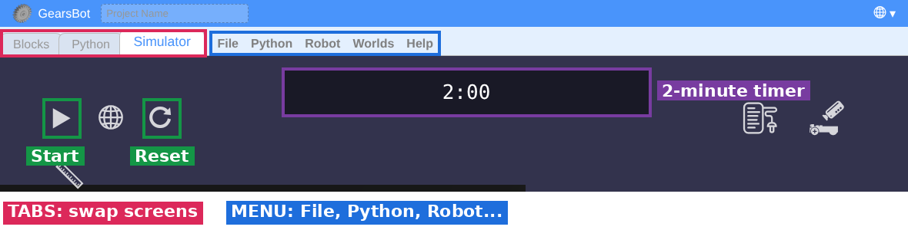
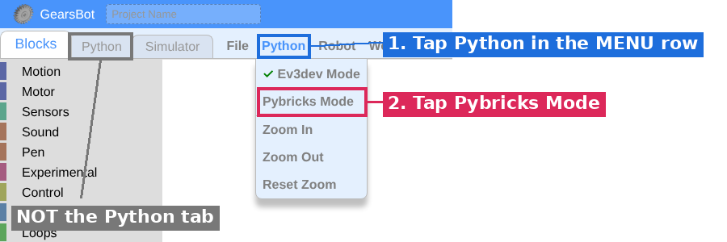
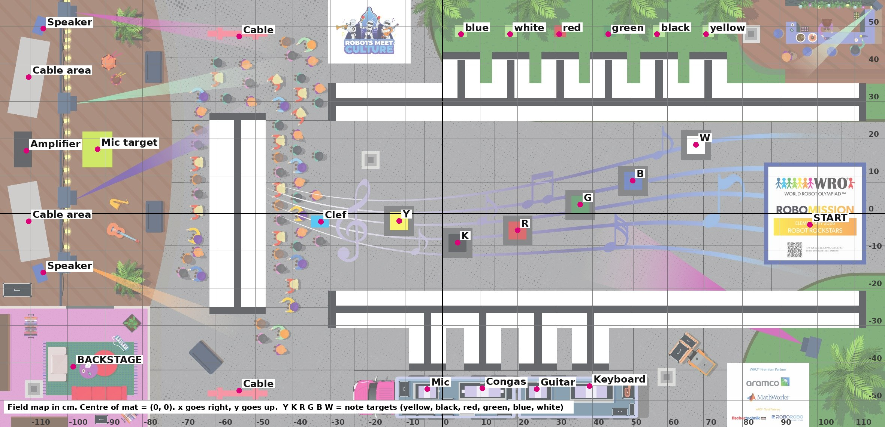

# 🤖 Robot Rockstars: learn Python with a robot

Practise for RoboMission on an iPad or computer. No robot needed, no sign-up, nothing to install.

## 👉 Start here

### 1. Open the practice field

**[▶️ Open the Robot Rockstars field](https://gears.aposteriori.com.sg/index.html?worldJSON=https%3A%2F%2Fraw.githubusercontent.com%2Ffindhiong%2Fmakers-practice-robomission%2Fmain%2Fworlds%2Frobot-rockstars-malaysia.json&robotJSON=https%3A%2F%2Fraw.githubusercontent.com%2Ffindhiong%2Fmakers-practice-robomission%2Fmain%2Frobots%2Fcage-bot.json)**

👆 **Press and hold** the link, then tap **Open in New Tab**, so you can keep these instructions open too.

The field and robot load by themselves. If a **What's New** box pops up, tap **OK**.

### 2. Get to know GearsBot

GearsBot has **three tabs** on the left. Tap one to swap screens:

| Tab | What it's for |
|---|---|
| **Blocks** | Build your program by dragging blocks, like you did at competition. |
| **Python** | See your program written in Python, and change it. |
| **Simulator** | See the field and the robot. Press ▶️ to start, and the curly arrow to put the robot back. |

Next to the tabs is a **menu row**: File, Python, Robot, Worlds, Help.

### 3. Switch on Pybricks (do this every time)

⚠️ There are **two** things called "Python". You need the one in the **menu row**, not the tab.

1. Tap **Python** in the **menu row** (between File and Robot).
2. Tap **Pybricks Mode**.

### 4. Do a mission

There are **8 missions**. They start easy (make the robot drive straight) and build up to a full 2-minute competition run. Missions 1 to 4 use **Blocks**, then Missions 5 to 8 use **Python**.

**[📋 Open the missions](missions/README.md)** and start with Mission 1. Each mission tells you how to name and save your work.

## 🗺️ The field map

The map shows where everything is, in centimetres. Keep it open while you plan.

---

# For grown-ups

## Sharing with other kids

Just share the link to this page. Everything works from a web browser: the field, robot and missions all load from here, and children don't need a GitHub or GearsBot account.

Work is kept in the browser between sessions on the same device, but only the latest program. Saving with **File > Save Python to your computer** keeps each mission. Clearing Safari's history or using a private tab wipes unsaved work.

## If the "Tap here" link doesn't work

You can load everything by hand in GearsBot (**https://gears.aposteriori.com.sg**):

1. On this page, open `worlds/robot-rockstars-malaysia.json` and tap the **download** button (the arrow pointing down, top right of the file).
2. In GearsBot, tap **Worlds > Load from file** and choose the downloaded file.
3. Tap **Robot > Select Robot**, choose **Cage Bot**, then **Ok**.
4. Tap **Python > Pybricks Mode**.

## What's in here

| Folder | What it is |
|---|---|
| `missions/` | Eight mission cards, from "drive straight" to a full 2-minute run, plus a scoring sheet. Missions 1 to 4 use Blocks, 5 to 8 use Python. |
| `missions/code/` | Starter Python for missions 5 to 8. |
| `worlds/` | The field: Malaysian Rookie Primary layout (fixed notes) and a shuffled-notes version. Both have a 2-minute timer. |
| `robots/` | The Cage Bot robot. |
| `images/` | The mat and the labelled field map. |

## The robot (Cage Bot)

| Port | Part |
|------|------|
| A | Left wheel |
| B | Right wheel |
| C | Cage motor (traps objects) |
| S1 | Colour sensor, looking down (left) |
| S2 | Colour sensor, looking down (right) |
| S3 | Colour sensor, looking forwards |
| S4 | Distance sensor |
| S5 | Gyro |

Wheels are 56 mm across and 152 mm apart.

## How this differs from the real robot

- **Python dialect.** GearsBot uses the Pybricks EV3 style (`DriveBase`, `GyroSensor`, `Port.S1`). On a SPIKE Prime hub with Pybricks firmware the ideas are the same, but the set-up lines differ (`PrimeHub`, `Port.A` to `Port.F`, `hub.imu` for the gyro). Everything about loops, sensors and gyro steering carries straight across.
- **No "twitch".** The simulator has no gear slack and nobody presses a button, so start-up problems only show up on a real robot.
- **Grabbing is simpler.** Pushing and caging objects behaves roughly like the real thing; picking things up does not.
- **Rules change each season.** The 2027 field will be new. This one is for learning the skills.

## Credits

The world files are adapted from the WRO 2026 Elementary world in [GearsBot](https://github.com/QuirkyCort/gears) by Cort Wee (GPL-3.0), with fixed note positions and a 2-minute timer added. The game mat is © World Robot Olympiad Association, published for teams to print and practise with.
