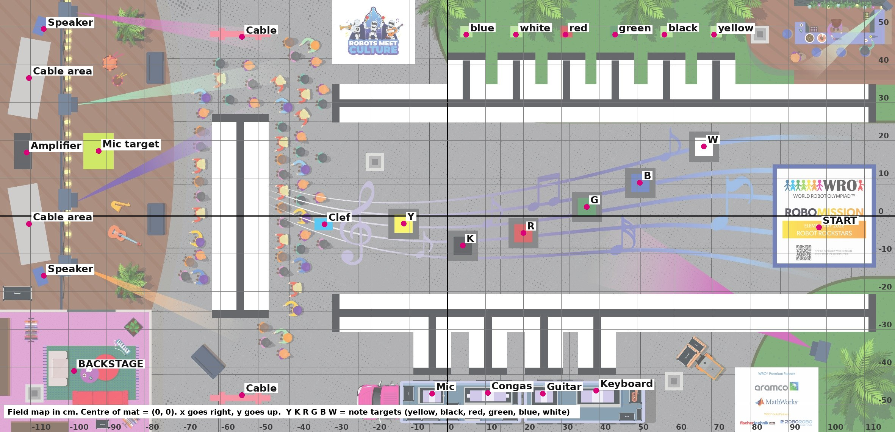

# 🤖 Robot Rockstars missions

Do the missions in order. Each one teaches **one new thing**.

| Mission | What you'll do | How |
|---|---|---|
| [1. The Clean Start](mission-1-clean-start.md) | Drive 30 cm perfectly straight | 🧱 Blocks |
| [2. The Perfect Turn](mission-2-perfect-turn.md) | Turn exactly a quarter turn | 🧱 Blocks |
| [3. Drive to Yellow](mission-3-drive-to-yellow.md) | Stop on the yellow box (with the grey outline) | 🧱 Blocks |
| [4. Stop at the Black Line](mission-4-stop-at-black.md) | Use a sensor to know when to stop | 🧱 Blocks |
| [5. Python Takes Over](mission-5-python-takes-over.md) | Drive to yellow using real Python | 🐍 Python |
| [6. Square Up on a Line](mission-6-square-up.md) | Use a line to make the robot perfectly straight | 🐍 Python |
| [7. Deliver a Note](mission-7-deliver-a-note.md) | Bring the red note to its target | 🐍 Python |
| [8. The Full Run](mission-8-full-run.md) | Score as many points as you can in 2 minutes | 🐍 Python |

## How missions work

Every mission card tells you exactly what to do, step by step:

1. **Before you start:** open the field, switch on Pybricks, and name your work.
2. **Build it** in Blocks (Missions 1 to 4) or **load the code** (Missions 5 to 8).
3. **Change it in Python:** guess first, then try it.
4. **You've finished when...** a challenge to prove you've got it.
5. **Save your work.**

## Team rules

- 👀 **Guess first.** Before you press ▶️, say what you think will happen.
- ⌨️ **Take turns.** One person taps, one person reads the card and the map. Swap every 10 minutes.
- 📓 **Write it down.** What did you change? What happened?
- 🗺️ **Use the Field Map.** Keep it open in another tab while you plan.

## 🗺️ The Field Map

**[Open the Field Map](../images/field-map.jpg)** (press and hold, then **Open in New Tab**). Every mission uses it.

**How to read it:**

- 📍 **Pink dots** show where things are. The label next to each dot tells you what it is.
- 🟨 **Yellow labels** are the **targets**: the coloured boxes with a grey outline where the notes go.
- 🟦 **Blue labels** at the top show where each **note starts**.
- 📏 **The grid lines are 10 cm apart.** The numbers along the bottom go **left and right** (x). The numbers down the right side go **up and down** (y).
- ➕ **The middle of the mat is 0.** Right of the middle is plus, left is minus. Above the middle is plus, below is minus.

> 🧮 **Example:** START is at x = 98 and the Yellow target is at x = -12. To get from one to the other, the robot travels 98 + 12 = **110 cm**.

> 💡 On an iPad, pinch to zoom in on the map.

When you're ready to score a whole run, use the [scoring sheet](scoring-sheet.md).
