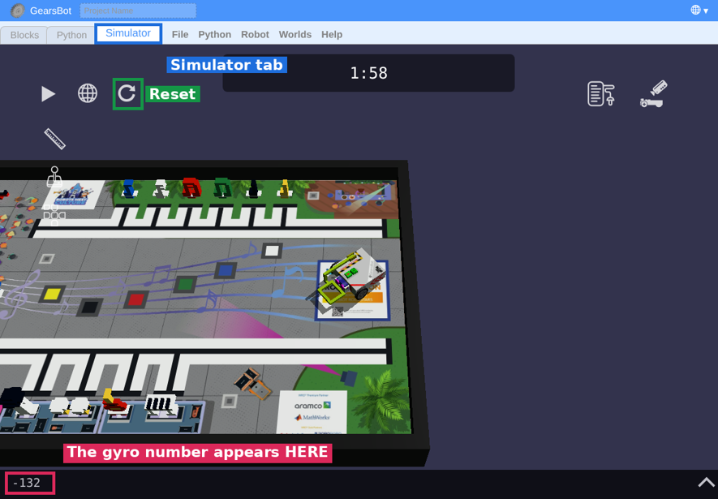

# Mission 2: The Perfect Turn 🔄

**Your goal:** Make the robot turn exactly a quarter turn (90 degrees), and check it with the gyro.

**Why it matters:** Every route on the field needs turns. A turn that's 5 degrees out sends the robot to the wrong place.

---

## Before you start 🏁

1. **[Open the field](https://gears.aposteriori.com.sg/index.html?worldJSON=https%3A%2F%2Fraw.githubusercontent.com%2Ffindhiong%2Fmakers-practice-robomission%2Fmain%2Fworlds%2Frobot-rockstars-malaysia.json&robotJSON=https%3A%2F%2Fraw.githubusercontent.com%2Ffindhiong%2Fmakers-practice-robomission%2Fmain%2Frobots%2Fcage-bot.json)** (press and hold, then **Open in New Tab**).
2. In the **menu row**, tap **Python**, then **Pybricks Mode**. ([Not sure where?](../README.md#3-switch-on-pybricks-do-this-every-time))
3. In the **Project Name** box at the very top, type `mission2`.
4. Open the **[🗺️ Field Map](../images/field-map.jpg)** (press and hold, then **Open in New Tab**). It shows where everything is. ([How to read it](README.md#-the-field-map))

## How to run the robot ▶️

1. Tap the **Simulator** tab.
2. Tap ▶️ to start.
3. To try again, tap the **curly arrow** to put the robot back at the start, then ▶️.

## Step 1: Build it in Blocks 🧱

Start with a `sleep for 1 seconds` block. Then add:

1. From **Motion**: `move steering with direction 100 and speed 30 % for 1 rotations`
   Direction 100 makes the robot spin on the spot.
2. From **Text**: a `print` block.
3. From **Sensors**: put a `gyro angle on port 5` block inside the print block.

Run it in the **Simulator** tab. When the robot stops, look at the **bottom of the Simulator screen**. The gyro's number appears there.



> 💡 The number only shows in the **Simulator** tab, never in the Blocks tab.

## Step 2: Make it exactly 90 🎯 (in Blocks)

Did the robot turn more or less than a quarter turn? You'll go back and forth between two tabs:

1. Tap the **Blocks** tab. In your move steering block, change the number of **rotations** (try a smaller number, like `0.8`).
2. Tap the **Simulator** tab. Tap the **reset** button (curly arrow) to put the robot back.
3. Tap ▶️.
4. Read the gyro number at the **bottom of the screen** and write it in the table.
5. Repeat until the gyro says about **90** (or **-90**).

| Rotations | Gyro said |
|---|---|
| 1 | |
| | |
| | |

## Step 3: Which way is positive? 🧭 (in Blocks)

In the **Blocks** tab, change the **direction** in your move steering block from `100` to `-100`. Watch which way it spins, and look at the gyro number.

Fill this in. **You'll need it for every mission after this.**

> Turning **right** makes the gyro go: ➕ or ➖
> Turning **left** makes the gyro go: ➕ or ➖

## Step 4: Change it in Python (guess first!) 🧪

> ⚠️ **Python changes happen in the Python tab only.** Once you change the Python, the Blocks tab locks. If you unlock it, your Python changes are lost. So do all your Blocks work first, then switch to Python.

In the **Python** tab, find these two lines:

```python
move_steering_for_degrees(-100, (30 / 100) * 1050, ___ * 360)
print(gyro_sensor_in5.angle())
```

(Your numbers may be a little different.) The first number is the **direction**, the second is the **speed**, the last is the **distance** in rotations.

> ✏️ **Guess first!** Before you press ▶️, write what you think will happen in the **We think...** column. For example: *"It will go twice as far."* Then press ▶️ and write what really happened.

| In the Python tab, change... | From | To | We think it will... | What happened |
|---|---|---|---|---|
| the **speed** | `30` | `100` | | |
| the **direction** | `-100` | `-50` | | |
| the **distance** | your number | double it | | |

---

## ✅ You've finished when...

Using **only the Python tab**, you can make the robot turn a quarter turn to the **left**, and the gyro says about **-90** (anything from -88 to -92).

## 📓 Notebook

- How many rotations made a perfect quarter turn?
- Try 4 quarter turns in a row. Does the robot end up facing exactly where it started?

## 💾 Save your work

1. In the **menu row**, tap **File**.
2. Tap **Save Python to your computer**, then **Download**.
3. Your work is saved as `mission2.zip`. To open it next time: **File > Load Python from your computer**.
